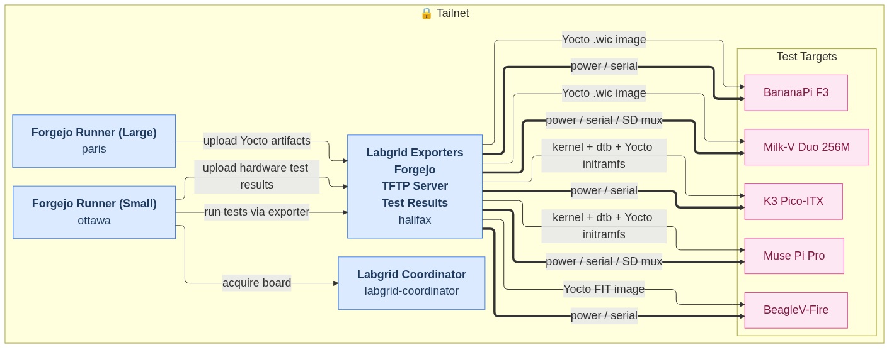

# boardgarden

tgamblin's boardfarm repo, built primarily for testing RISC-V development boards (plus QEMU targets) with [Labgrid](https://github.com/labgrid-project/labgrid) and [Forgejo](https://forgejo.org/) Actions

## Table of Contents

- [Motivation](#motivation)
  - [Why Forgejo?](#why-forgejo)
  - [Why Labgrid?](#why-labgrid)
- [Network Diagram](#network-diagram)
- [Usage](#usage)
  - [.forgejo](#forgejo)
  - [boards](#boards)
  - [systemd_services](#systemd_services)
  - [ansible](#ansible)
  - [udev](#udev)

## Motivation

As part of the [RISE Project](https://riseproject.dev/),
[BayLibre](https://baylibre.com/) is improving support for RISC-V hardware and
software within the [Yocto Project](https://www.yoctoproject.org/). This
manifests in two main categories:

1. Triaging issues discovered while building and performing runtime testing of
   RISC-V systems using the
   [openembedded-core](https://git.openembedded.org/openembedded-core/) layer
   (which supports RISC-V via QEMU-based `qemuriscv32` and `qemuriscv64`
   `MACHINE` options)
2. Improving the [meta-riscv](https://github.com/riscv/meta-riscv) layer's
   support for widely-available RISC-V development boards, and ensuring it
   remains compliant with Yocto Project compatibility standards

`boardgarden` was built to address these challenges in an automated fashion, and
to serve as a useful reference to others who may want to build out their own
automated testing infrastructure.

### Why Forgejo?

1. Broadly compatible with GitHub Actions (therefore familiar to many users)
2. Convenient features for a forge (repository mirroring and sync, container
   registry, issue tracking, statistics, wiki)
3. Lightweight

### Why Labgrid?

1. Mature project with existing support for automated remote control of many
   devices, including USB-to-UART bridges, power switches, and [USB SD Mux](https://linux-automation.com/en/products/usb-sd-mux.html)
2. Hardware details abstracted away from user
3. Simple YAML configuration files
4. Uses `pytest` for test suites

## Network Diagram

## Usage

### .forgejo

These should mostly just work on a sufficiently-resourced Forgejo instance with
Actions enabled. The workflows fall into a few groups:

- Scheduled (nightly or weekly) Yocto build and board test pipelines
- Scheduled recipe upgrade jobs (`upgrade-linux-mainline`, `upgrade-u-boot`,
  `upgrade-opensbi`), which use the external
  [recipe-upgrade](https://forgejo.baylibre.com/tgamblin/recipe-upgrade) actions
- On-demand comparisons such as `ptest-kvm-compare`
- Repository checks run on push (`lint-board-files`, `lint-workflows`,
  `unit-tests`, `validate-manifests`)

The build and test pipelines target some combination of:

- Packages whose test suites are known to have intermittent failure issues when
  run on `qemuriscv64` in the Yocto Project [Autobuilder](https://autobuilder.yoctoproject.org/valkyrie/)
- Board support packages (BSPs) provided by the
  [meta-riscv](https://github.com/riscv/meta-riscv) layer for various RISC-V
  development boards

The `bitbake-configs` directory contains templates for running Yocto-specific
workflows, while the `dockerfiles` directory contains definitions for the
`container-builder`, `kernel-builder`, `labgrid-operator`, `qemu-builder`, and
`yocto-builder` container images
stored in the registry.

For the list of runners, repository secrets, and repository variables these
workflows expect, see [docs/runners.md](docs/runners.md). It also contains a
migration checklist for spinning boardgarden up on a fresh Forgejo instance.

### boards

The repository is a [uv](https://docs.astral.sh/uv/) workspace: the root
`pyproject.toml` pulls in the top-level `common` package (`boardfarm-common`)
as a workspace member. This allows re-use of various Labgrid strategy
functions and pytest fixtures across multiple boards, since the fundamental
actions used (such as setting a TFTP server's IP address on the U-Boot prompt)
are more or less the same.

Assuming you have `uv` installed, you can set up the Python virtual environment
with all of the necessary modules by doing `uv sync`.

Using the board configurations will depend on how you have structured your
Labgrid deployment (see the [docs](https://labgrid.readthedocs.io/en/latest/)
for more details). **In addition, you may need to make some basic changes to the
default bootloaders and operating systems in place** before beginning to use the
Labgrid configurations for automation. For example, `muse-pi-pro` keeps an
[Armbian](https://armbian.com/boards) installation on eMMC as a fallback
even though it boots test images from an SD Mux. Vendor U-Boot environments
include default settings (such as autoboot wait times) that you may want to
change before deployment - please ensure that you review them.

As an example, once you have created a place called
`tg-muse-pi-pro` and exported the corresponding resources in
`boards/muse-pi-pro/exporter.yaml` with an appropriate matching pattern, you
should be able to invoke the labgrid CLI using `uv run`, e.g.:

1. `uv run labgrid-client -p tg-muse-pi-pro acquire`
2. `uv run labgrid-client -p tg-muse-pi-pro -c boards/muse-pi-pro/client.yaml -s sd con`

Or, if you want to run the test suite, you can do:

1. `uv run labgrid-client -p tg-muse-pi-pro acquire`
2. `uv run pytest -vvv --html=report.html --self-contained-html boards/muse-pi-pro`

These same general concepts are employed by the pipelines inside the
`.forgejo/workflows` directory, so that should be considered a more complete
reference.

### systemd_services

Unit files for running the Labgrid coordinator and exporter processes on one
or more systems. See [systemd_services/README.md](systemd_services/README.md)
for install steps and configuration.

### ansible

Provisioning for boardgarden's container hosts — the start of migrating
bare-metal services (tftpd-hpa, the report file server, the Labgrid
coordinator, Forgejo) to containers, one service at a time. See
[ansible/README.md](ansible/README.md).

### udev

udev rules for the Labgrid exporter hosts:

- `90-copilot.rules`: GPIO and tty symlinks for the [BayLibre
  Copilot](https://github.com/BayLibre/Copilot) board, which provides remote
  power control and the serial console (UART) for boards under test
- `90-spacemit-fastboot.rules`: access to SpacemiT devices in USB download
  mode, for fastboot flashing
- `99-gpio.rules`: sysfs GPIO permissions, and a flag for selecting the legacy
  sysfs gpiochip node in board match rules

These have only been deployed thus far on Debian-based systems, where the
`/sys/class/gpio` path exists and the necessary Linux kernel configuration is
enabled.
