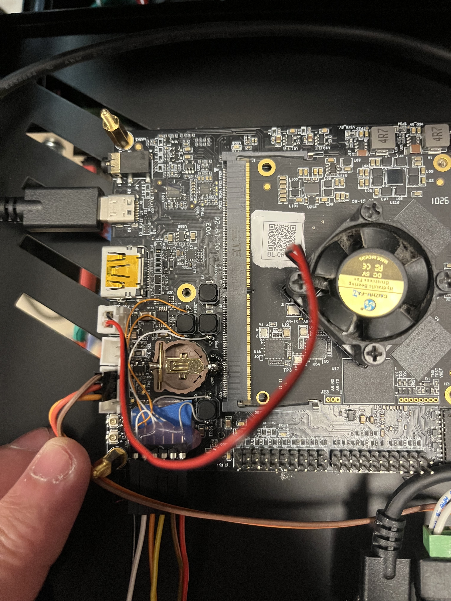
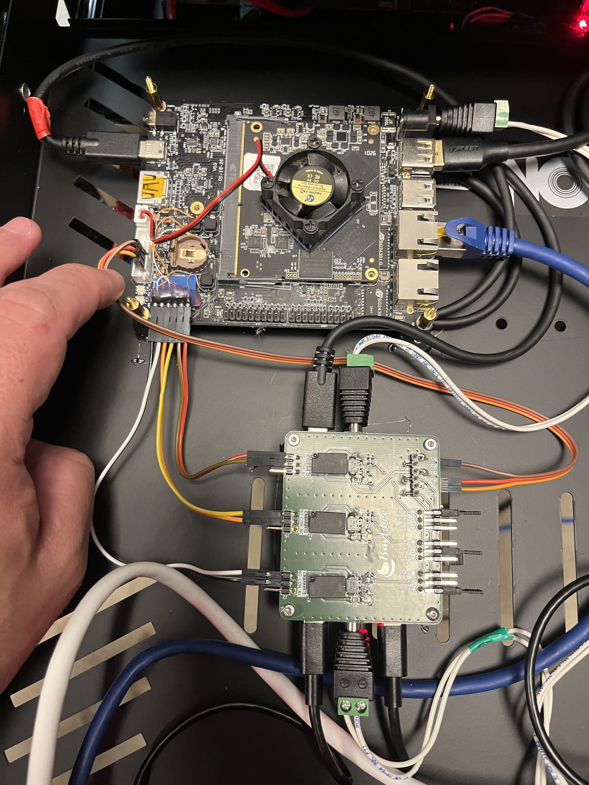
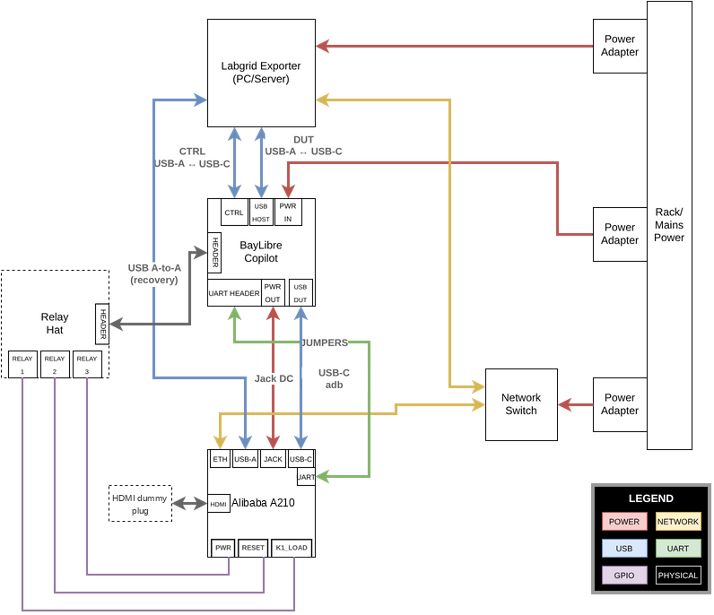
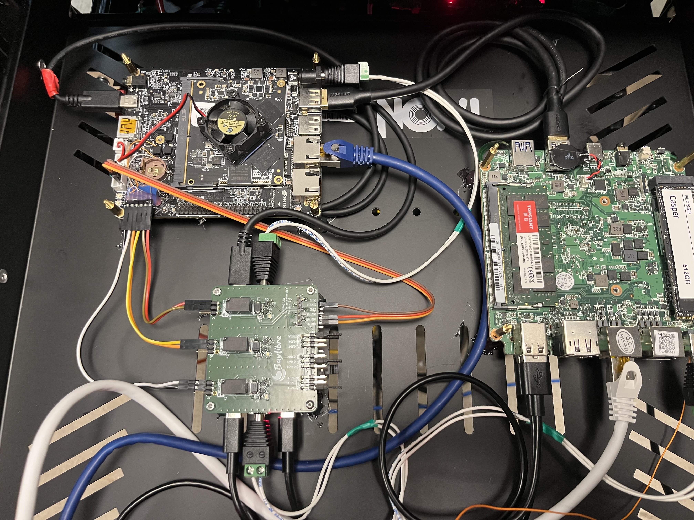

# Alibaba A210: Automated Fastboot Setup Guide

This walks through configuring all aspects of preparing an Alibaba A210 development board (sold as the Zhihe A210 SODIMM V2) for use with Labgrid's `fastboot` support in an automated testing environment. **It assumes that you already have at least one computer with a typical Linux distribution (e.g. Debian) preinstalled, with administrative access.** It also assumes that you have already read the board's [flashing guide][a210-flashing-guide-ref], specifically on how to put the board into download mode and flash it manually.

This guide covers the hardware and the preparation of the Labgrid exporter machine. **It does not cover the Labgrid configuration of the board yet:** this repository does not contain an A210 board directory under [boards](../boards/), so the exporter, place, and test steps are left as a TODO in [section 2.4](#24-todo-labgrid-configuration).

## 1. Hardware Setup

### 1.1 Requirements

- Alibaba A210 development board
- [BayLibre Copilot][baylibre-copilot-ref] helper board
- [BayLibre Copilot Relay Hat][baylibre-copilot-relay-ref] board
- A 12 V DC power supply (the Copilot's barrel jack power channel is [rated][baylibre-copilot-tech-ref] from 5 V up to 48 V at 5 A)
- One barrel jack power cable
- Two USB-A-to-C cables
- One USB cable with a USB-C plug on the A210 side
- One USB-A-to-A cable
- Nine (9) female-to-female breadboard wires or similar
- An HDMI dummy plug (headless display emulator)
- An Ethernet cable
- (Optional) a USB hub with ports matching the cable types used
- Soldering tools, a multimeter, and B-7000 glue or similar (recommended)
- Nylon or metal standoffs

### 1.2 Adding Custom Wiring to the A210

The board's [flashing guide][a210-flashing-guide-ref] indicates that the Flash button must be held while briefly pressing the Reset button to enter flashing mode. On the board's silkscreen these are labelled `K1_LOAD` and `RESET`, and the Power button is labelled `PWR`; this guide uses the silkscreen names. The board also does not start on its own when 12 V is applied, with or without USB cables connected: `PWR` must be pressed to boot it, so the `PWR` relay is required, not optional. Wires must be attached to the solder points for each of these buttons, so that they can be connected to the Copilot Relay Hat and controlled remotely.

1. Locate the `K1_LOAD`, `RESET`, and `PWR` buttons around the RTC battery holder: `K1_LOAD` is on one side of it, and `RESET` and `PWR` are next to each other on the other side. Do not confuse them with the `STANDBY` button next to `PWR`, which is not used.
2. Using six (6) breadboard wires, cut one end off each and strip them to expose the metal contacts. Leave the other end intact, since it will be attached to the relay hat later.
3. Solder wires to each pin for the `K1_LOAD`, `RESET`, and `PWR` buttons (two wires per button).
4. Ensure there are no shorts between the pins after soldering by using a multimeter, as this could cause unexpected behaviour in testing.
5. (Recommended) apply glue or tape over the newly-soldered wires, to help with strain relief. Make sure to give glue time to dry/cure. The result should look something like:



### 1.3 Connecting the Devices

1. Attach the Copilot relay hat to the Copilot base board, including standoffs.
2. Connect three (3) breadboard wires from the A210 debug UART connector (the 4-pin connector on the board's edge; its pins are, in order, NC, `TX`, `RX`, `GND`) to the Copilot's UART pins, making sure that the `RX` pin on one side is connected to `TX` on the other, and vice versa.
3. Connect the wires soldered to the A210 to the headers on the Copilot relay hat. For consistency with the wiring diagram below, use relay 1 for `K1_LOAD`, relay 2 for `RESET`, and relay 3 for `PWR`:



4. Connect the USB cable between the Copilot's `USB DUT` port and the A210's USB-C port. This is the adb connection, and it reaches the exporter through the Copilot's `USB HOST` port. Once Android has booted, the board enumerates on it as `18d1:4ee7` (`Zhihe A210 EVB`).
5. Connect the USB-A-to-C cable between the PC (or USB hub) and the Copilot's `USB HOST` port.
6. Connect the USB-A-to-A recovery cable between the PC (or USB hub) and the A210's USB-A port labelled `LOAD USB`. All fastboot traffic goes through this port: the board enumerates on it in download mode (`37f2:d00d`), and U-Boot's fastboot uses it as well.
7. Connect the cable between the Copilot's power output and the A210's DC jack.
8. Connect the power supply to the Copilot power input.
9. Connect the final USB-A-to-C cable between the PC (or USB hub) and the Copilot's `CTRL` port.
10. Connect the Ethernet cable between the A210 and the network switch.
11. Plug the HDMI dummy plug into the A210's HDMI output.
12. Reference the following diagram to ensure connections are made correctly:



A completed setup may look something like:



## 2. Software Setup

The following instructions are intended to be fairly agnostic, but follow the design choices made within this repository, such as a dedicated `labgrid` user that runs the exporter. Labs with many users or several exporter machines may need changes not covered here.

### 2.1 Requirements

- A Linux-based operating system with the sysfs GPIO interface enabled in the kernel. This is deprecated and a new class device interface is provided to replace it (see [here](https://lore.kernel.org/all/20250704-gpio-sysfs-chip-export-v4-0-9289d8758243@linaro.org/)), but for now this guide assumes the legacy interface is available. This is true in Debian 13, as of November 2026.
- Administrative access for configuring user accounts, groups, and udev rules
- Python tooling (the boardgarden repository relies on [uv](https://docs.astral.sh/uv/))

### 2.2 Initial Labgrid Setup

1. Create udev rules according to the [Copilot Guide][baylibre-copilot-guide-ref], referencing the files in the [udev](../udev/) path where necessary. Fastboot also needs a rule that gives the `labgrid` user access to the A210 in download mode, and that sets `adb_user=yes` so that Labgrid accepts the device as a fastboot device. [90-zhihe-fastboot.rules](../udev/90-zhihe-fastboot.rules) does this for the boot ROM (`37f2:d00d`) and for the flashing U-Boot it loads, which comes back under another USB ID and is matched by its fastboot interface instead. The same file gives access to the board once Android has booted (`18d1:4ee7`), for `adb`. **This file is not part of the Copilot setup, so install it as well.**
2. Create a `labgrid` system user and group, with `/home/labgrid` as its home directory. The [exporter unit](../systemd_services/labgrid-exporter@.service) runs as this user, and the paths in the board configurations (e.g. `fastboot.image_dir` in `board.yaml`) assume this home directory:

   ```bash
   sudo groupadd --system gpio   # if it does not already exist
   sudo useradd --system --create-home --home-dir /home/labgrid --shell /bin/bash labgrid
   sudo usermod -aG dialout,plugdev,gpio labgrid
   ```

   Each group is needed for a different device:

   - `dialout`: the Copilot's USB serial port (the A210 console)
   - `plugdev`: the Copilot gpiochip and tty ([90-copilot.rules](../udev/90-copilot.rules)), and the A210 USB device in download mode and under Android ([90-zhihe-fastboot.rules](../udev/90-zhihe-fastboot.rules))
   - `gpio`: `/sys/class/gpio/export` and `unexport` ([99-gpio.rules](../udev/99-gpio.rules))

3. Install the `fastboot` and `adb` binaries on the exporter machine. Labgrid runs `fastboot` as the `labgrid` user, and `adb` is used to reach the board once Android has booted. Distribution packages are often outdated, so install the latest [Android SDK Platform-Tools][platform-tools-ref] from Google instead, and link the binaries into a directory that is in the `PATH` of every user:

   ```bash
   curl -LO https://dl.google.com/android/repository/platform-tools-latest-linux.zip
   sudo unzip -o platform-tools-latest-linux.zip -d /opt
   sudo ln -sf /opt/platform-tools/fastboot /opt/platform-tools/adb /usr/local/bin/
   fastboot --version
   adb version
   ```

   If the distribution's `fastboot` or `adb` packages are installed, remove them so that the versions in `/usr/local/bin` are the only ones.

4. Reload the udev rules, then reconnect the Copilot (or trigger the rules manually):

   ```bash
   sudo udevadm control --reload
   sudo udevadm trigger
   ```

   The Copilot should now appear under `/dev/copilot/by-id/<serial>/`, with both a `tty` and a `gpiochip` symlink.

### 2.3 Checking the Hardware by Hand

Before any Labgrid configuration, check that the exporter machine sees the board in download mode:

1. Apply power, then press `PWR` to start the board.
2. Hold `K1_LOAD`, press and release `RESET`, then release `K1_LOAD`.
3. Check that the board enumerates on the recovery cable and answers to `fastboot`, as the `labgrid` user:

   ```bash
   lsusb -d 37f2:
   sudo -u labgrid fastboot devices
   ```

If `fastboot devices` lists nothing while `lsusb` shows the device, [90-zhihe-fastboot.rules](../udev/90-zhihe-fastboot.rules) is not installed or the `labgrid` user is not in the `plugdev` group (see [section 2.2](#22-initial-labgrid-setup)).

### 2.4 TODO: Labgrid Configuration

> **TODO:** this repository does not contain an A210 board directory yet. The exporter configuration, the exporter service, the Labgrid place, the smoke test, and the CI integration will be documented here once it exists.

What remains to be done, following [onboard-a-board.md](./onboard-a-board.md):

- Add `boards/<a210>/` with its `board.yaml`, `exporter.yaml`, and `strategy.py`. The [K3 Pico-ITX fastboot guide](./k3-fastboot-setup.md) shows the remaining steps for a board that already has them.
- Write a strategy for the A210. The shared `FastbootFlashStrategy` cannot be used as-is:
  - It never presses `PWR`, and the A210 does not start after a power cycle until `PWR` is pressed.
  - It stages images with `fastboot stage` and `fastboot continue`. The A210's boot ROM instead loads each bootloader stage to RAM with `fastboot flash ram` followed by `fastboot reboot`, as described in the board's [flashing guide][a210-flashing-guide-ref].
- Pin the `fastboot` resource in `exporter.yaml` to the USB port of the recovery cable with `ID_PATH`. Both the boot ROM and the flashing U-Boot enumerate on that port, under different USB IDs.
- Add tests for Android. The shared tests in `common/src/boardfarm_common/tests` were written for Yocto images.
- Set `exclude_from_nightly: true` in `board.yaml`: the nightly CI jobs build Yocto images and require a `yocto_machine` for every board.

## References

- [A210 SODIMM V2 Development Board Flashing Guide][a210-flashing-guide-ref]
- [K3 Pico-ITX fastboot setup guide](./k3-fastboot-setup.md)
- [Android SDK Platform-Tools][platform-tools-ref]
- [BayLibre Copilot][baylibre-copilot-ref]
- [BayLibre Copilot Relay Hat][baylibre-copilot-relay-ref]
- [BayLibre Copilot Getting Started Guide][baylibre-copilot-guide-ref]
- [BayLibre Copilot Technical Information][baylibre-copilot-tech-ref]

[a210-flashing-guide-ref]: https://developer.zhcomputing.com/en/docs/A210/A210_SODIMM_V2_Burning_Instruction_EN/
[platform-tools-ref]: https://developer.android.com/tools/releases/platform-tools
[baylibre-copilot-ref]: https://github.com/BayLibre/Copilot
[baylibre-copilot-relay-ref]: https://github.com/BayLibre/Copilot_Extension_Triple_Relays
[baylibre-copilot-guide-ref]: https://baylibre.github.io/Copilot/getting-started.html
[baylibre-copilot-tech-ref]: https://baylibre.github.io/Copilot/technical-information.html
