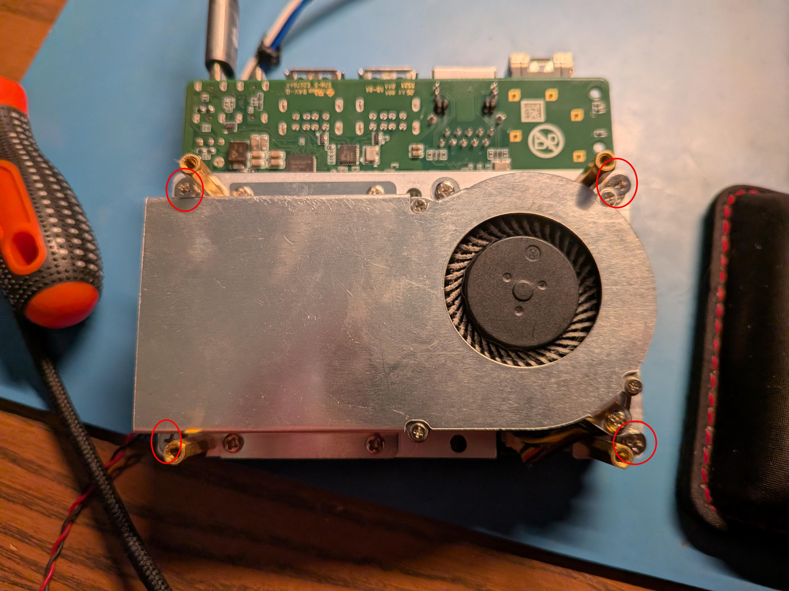
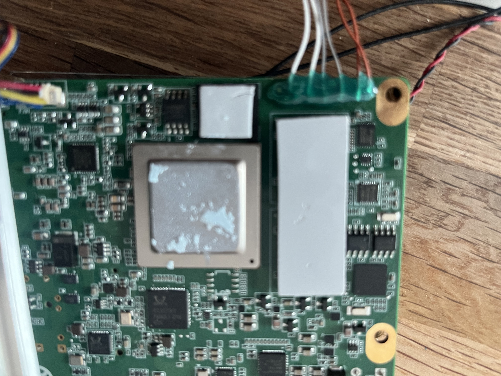
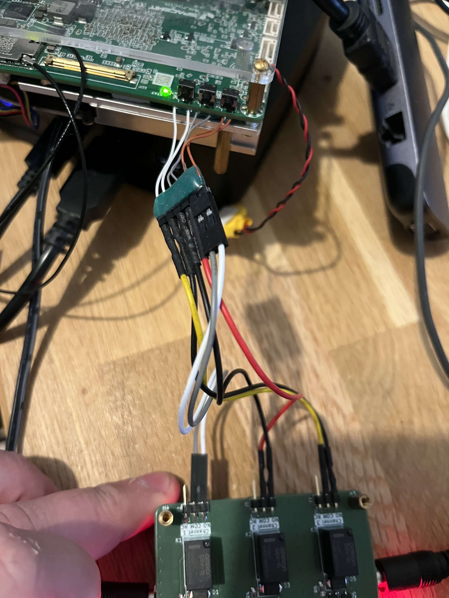
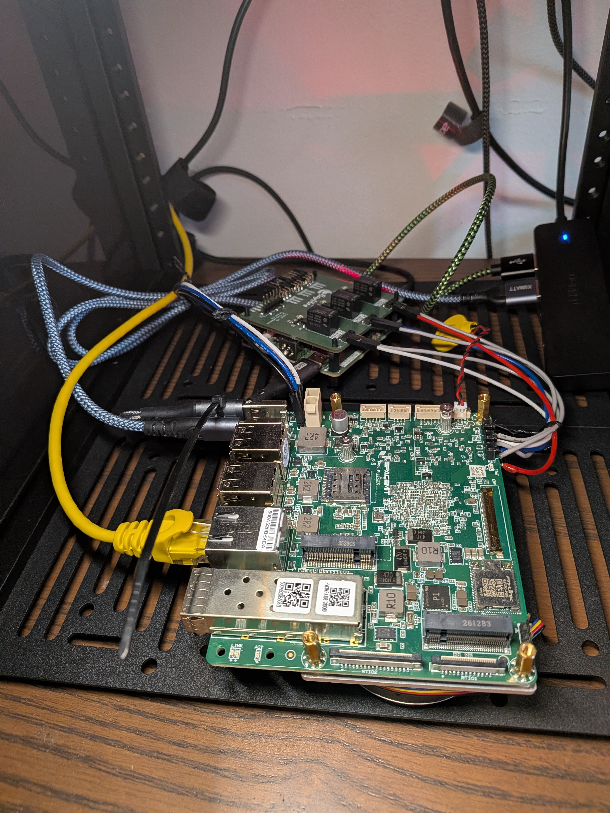

# K3 Pico-ITX: Automated Fastboot Setup Guide

This walks through configuring all aspects of preparing a SpacemiT K3 Pico-ITX development board for use with Labgrid's `fastboot` support in an automated testing environment. **It assumes that you already have at least one computer with a typical Linux distribution (e.g. Debian) preinstalled, with administrative access.** It also assumes that you have already read the [K3 Pico-ITX Getting Started Guide][getting-started-guide-ref], specifically on how to manually flash the board.

This guide covers the hardware, the Labgrid exporter machine, and the Labgrid configuration for the `k3-pico-itx-8gb` board in this repository, ending with a manual test run. It does not cover configuring a CI system, though [section 3](#3-notes-for-ci-integration) describes how one would use the result. The `k3-pico-itx-32gb` board in this repository boots over TFTP rather than fastboot, so most of this guide does not apply to it.

## 1. Hardware Setup

### 1.1 Requirements

- [K3 Pico-ITX][k3-pico-itx-ref] development board
- [BayLibre Copilot][baylibre-copilot-ref] helper board
- [BayLibre Copilot Relay Hat][baylibre-copilot-relay-ref] board
- 65W generic/laptop USB-C power supply for the K3 Pico-ITX
- One USB-C-to-C cable, for power connection from Copilot to K3 Pico-ITX input
- Two USB-A-to-C **or** two USB-C-to-C cables - one for connection from the Labgrid exporter machine to the BayLibre Copilot, and one for connection from the exporter machine to the K3 Pico-ITX flashing port
- Female-to-female breadboard wires or similar - three (3) for UART, six (6) for relay board
- (Optional) an ethernet cable for the board
- (Optional) a USB hub with ports matching the cable types used
- Soldering tools, a multimeter, and B-7000 glue or similar (recommended)
- Nylon or metal standoffs

### 1.2 Adding Custom Wiring to the K3 Pico-ITX

The K3 Pico-ITX [Getting Started Guide][getting-started-guide-ref] indicates that the `FDL` button must be held while briefly pressing the `RST` button to enter flashing mode. Wires must be attached to the solder points for each of these buttons, so that they can be connected to the Copilot Relay Hat and controlled remotely.

1. Remove the screws holding the heatsink in place (circled in red):



2. Once the heatsink has been removed, note the six solder points along the bottom left of the board, corresponding to the `RST`, `FDL`, and `PWR` buttons (two pins each):


3. Using six (6) breadboard wires, cut one end off each and strip them to expose the metal contacts. Leave the other end intact, since it will be attached to the relay hat later.
4. Solder wires to each pin for the `RST` (circled in red) and `FDL` (yellow) buttons. The `PWR` (light blue) button is optional.
5. Ensure there are no shorts between the pins after soldering by using a multimeter, as this could cause unexpected behaviour in testing.
6. (Recommended) apply glue along the board's edge near the newly-soldered pins, to help with strain relief. Make sure to give it time to dry/cure. The result should look something like:



7. When finished, re-attach the board's heatsink.

### 1.3 Connecting the Devices

1. Attach the Copilot relay hat to the Copilot base board, including standoffs.
2. Connect three (3) breadboard wires from the K3 Pico-ITX UART header to the Copilot's UART pins, making sure that the `RX` pin on one side is connected to `TX` on the other, and vice versa.
3. Connect the wires soldered to the K3 Pico-ITX to the headers on the Copilot relay hat. For consistency with the configurations in this repository, the wiring should match that shown below:



4. Connect the USB-C cable intended for fastboot between the PC (or USB hub) and the K3 Pico-ITX. Note that the [Getting Started Guide][getting-started-guide-ref] suggests that this should be connected after switching to flashing mode, but it works regardless.
5. Connect the USB-C-to-C cable between the Copilot and the K3 Pico-ITX's power input. Note that due to limitations with USB-C wiring, it is possible that one connection may need to be reversed for power passthrough to work. See the Copilot [getting started guide][baylibre-copilot-guide-ref] for more information.
6. Connect the USB-C power cable to the Copilot power input.
7. Connect the final USB-C cable between the PC (or USB hub) and the Copilot's control input.
8. (Optional, if in use) connect the Ethernet cable to the K3 Pico-ITX.
9. A completed setup may look something like:



## 2. Software Setup

The following instructions are intended to be fairly agnostic, but follow the design choices made within this repository, such as a dedicated `labgrid` user that runs the exporter. Labs with many users or several exporter machines may need changes not covered here.

### 2.1 Requirements

- A Linux-based operating system with the sysfs GPIO interface enabled in the kernel. This is deprecated and a new class device interface is provided to replace it (see [here](https://lore.kernel.org/all/20250704-gpio-sysfs-chip-export-v4-0-9289d8758243@linaro.org/)), but for now this guide assumes the legacy interface is available. This is true in Debian 13, as of November 2026.
- Administrative access for configuring user accounts, groups, and udev rules
- Python tooling (the boardgarden repository relies on [uv](https://docs.astral.sh/uv/))

### 2.2 Initial Labgrid Setup

1. Create udev rules according to the [Copilot Guide][baylibre-copilot-guide-ref], referencing the files in the [udev](../udev/) path where necessary. Note that the [90-spacemit-fastboot.rules](../udev/90-spacemit-fastboot.rules) file is unique to the fastboot process and not part of the Copilot setup - **you must apply something similar for fastboot usage via Labgrid**.
2. Create a `labgrid` system user and group, with `/home/labgrid` as its home directory. The [exporter unit](../systemd_services/labgrid-exporter@.service) runs as this user, and the paths in the board configurations (e.g. `fastboot.image_dir` in [board.yaml](../boards/k3-pico-itx-8gb/board.yaml)) assume this home directory:

   ```bash
   sudo groupadd --system gpio   # if it does not already exist
   sudo useradd --system --create-home --home-dir /home/labgrid --shell /bin/bash labgrid
   sudo usermod -aG dialout,plugdev,gpio labgrid
   ```

   Each group is needed for a different device:

   - `dialout`: the Copilot's USB serial port (the K3 Pico-ITX console)
   - `plugdev`: the Copilot gpiochip and tty ([90-copilot.rules](../udev/90-copilot.rules)), and the SpacemiT USB device in download mode ([90-spacemit-fastboot.rules](../udev/90-spacemit-fastboot.rules))
   - `gpio`: `/sys/class/gpio/export` and `unexport` ([99-gpio.rules](../udev/99-gpio.rules))

3. Install the `fastboot` binary on the exporter machine. Labgrid runs it as the `labgrid` user. On Debian:

   ```bash
   sudo apt install fastboot
   ```

4. Reload the udev rules, then reconnect the Copilot (or trigger the rules manually):

   ```bash
   sudo udevadm control --reload
   sudo udevadm trigger
   ```

   The Copilot should now appear under `/dev/copilot/by-id/<serial>/`, with both a `tty` and a `gpiochip` symlink.

### 2.3 Installing boardgarden

As the `labgrid` user, clone this repository to the location the exporter unit expects, then create the Python virtual environment:

```bash
sudo -iu labgrid
git clone <boardgarden-url> /home/labgrid/boardgarden
cd /home/labgrid/boardgarden
uv sync
```

The exporter unit runs `labgrid-exporter` from `boards/.venv`. If you use a different checkout location, set `BOARDGARDEN_ROOT` in `/etc/labgrid/boardgarden.env` (see [section 2.5](#25-coordinator-and-exporter-services)).

### 2.4 Matching the Hardware in `exporter.yaml`

[exporter.yaml](../boards/k3-pico-itx-8gb/exporter.yaml) identifies the Copilot by its USB serial number and identifies the fastboot device by its USB port. Both values are specific to your setup, so they must be updated.

1. Find the Copilot's serial number:

   ```bash
   ls /dev/copilot/by-id/
   udevadm info /dev/copilot/by-id/*/tty | grep ID_SERIAL_SHORT
   ```

   Replace each `ID_SERIAL_SHORT` value (`DU0ET816` in this repository) with your serial number. The `serial` resource and all four GPIO resources use it.

2. Check that the GPIO pins match your relay wiring. The configurations in this repository use:

   | Pin | Resource | Purpose |
   |-----|----------|---------|
   | 0 | `power-gpio` | Copilot power passthrough to the K3 Pico-ITX |
   | 1 | `pwr-gpio` | `PWR` button (optional) |
   | 2 | `fdl-gpio` | `FDL` button (download mode) |
   | 3 | `rst-gpio` | `RST` button |

   If you wired the relay hat differently from the photo in [section 1.3](#13-connecting-the-devices), change the `pin` values to match.

3. Find the USB path of the fastboot port. Put the board into download mode by hand: hold `FDL`, press and release `RST`, then release `FDL`. Then find the SpacemiT device (vendor ID `361c`) and its `ID_PATH`:

   ```bash
   lsusb -d 361c:
   udevadm info /dev/bus/usb/<bus>/<device> | grep ID_PATH=
   ```

   Replace the `ID_PATH` value under the `fastboot` resource. `ID_PATH` is used instead of `sys_name` because the board can enumerate on either the USB2 or the USB3 bus of the same physical port, which changes `sys_name` but not `ID_PATH`. **Moving the cable to another port or hub changes this value.**

4. The `tftp` resource is only used by the TFTP-booted variants (see `variants:` in [board.yaml](../boards/k3-pico-itx-8gb/board.yaml)), not by fastboot. Either update its `host` and paths to match your TFTP server, or remove it if you only use fastboot.

5. If you have more than one board, also rename the place (`tg-k3-pitx-8gb`) in `exporter.yaml` and `remote_place` in [board.yaml](../boards/k3-pico-itx-8gb/board.yaml). Then regenerate the client configurations:

   ```bash
   uv run boardfarm-render boards/k3-pico-itx-8gb
   ```

### 2.5 Coordinator and Exporter Services

Install the systemd units as described in the [systemd_services README](../systemd_services/README.md). The coordinator can run on the exporter machine or elsewhere, but the exporter machine must be able to reach it on port 20408. In summary:

```bash
sudo cp systemd_services/labgrid-coordinator.service systemd_services/labgrid-exporter@.service /etc/systemd/system/
sudo mkdir -p /etc/labgrid
echo "LG_COORDINATOR=<coordinator-host>" | sudo tee /etc/labgrid/boardgarden.env
sudo systemctl daemon-reload

# on the coordinator machine
sudo systemctl enable --now labgrid-coordinator.service

# on the exporter machine
sudo systemctl enable --now labgrid-exporter@k3-pico-itx-8gb.service
```

The instance name after `@` must match the board's directory under [boards](../boards/). Check that the exporter started cleanly and registered its resources:

```bash
journalctl -u labgrid-exporter@k3-pico-itx-8gb.service -f
export LG_COORDINATOR=<coordinator-host>
uv run labgrid-client resources
```

`labgrid-client` reads the coordinator address from `LG_COORDINATOR`, so set it in every shell used for the following sections.

If the `fastboot` resource is listed as unavailable, this is expected while the board is not in download mode.

### 2.6 Creating the Place

Create the place named in `board.yaml`, match it to the exporter's resources, and tag it with the board's Yocto `MACHINE`. The tag must match `yocto_machine` in `board.yaml`, since automated jobs use it to find boards (see [section 3](#3-notes-for-ci-integration)):

```bash
uv run labgrid-client -p tg-k3-pitx-8gb create
uv run labgrid-client -p tg-k3-pitx-8gb add-match 'k3-pico-itx-8gb-exporter/tg-k3-pitx-8gb/*'
uv run labgrid-client -p tg-k3-pitx-8gb set-tags machine=k3-pico-itx
uv run labgrid-client -p tg-k3-pitx-8gb show
```

The match pattern has the form `<exporter name>/<resource group>/<class>`. The exporter unit names the exporter `<board directory>-exporter`, and the resource group is the top-level key in `exporter.yaml`.

### 2.7 Staging Images and Smoke Testing

1. Build the flash images by following the `docs/k3-pico-itx.md` guide in the [meta-riscv][meta-riscv-ref] layer. Then put them in `fastboot.image_dir` (by default `/home/labgrid/k3-pico-itx-fastboot`). Every file named under `fastboot.stage` and `fastboot.flash` in [board.yaml](../boards/k3-pico-itx-8gb/board.yaml) must be present, including the partition layouts from the board directory:

   ```bash
   mkdir -p /home/labgrid/k3-pico-itx-fastboot
   cp <yocto-deploy-dir>/{FSBL.bin,u-boot.itb,bootinfo_spinor.bin,u-boot-env-default.bin,esos.itb,fw_dynamic.itb,bootfs.ext4,rootfs.ext4} /home/labgrid/k3-pico-itx-fastboot/
   cp boards/k3-pico-itx-8gb/*.json /home/labgrid/k3-pico-itx-fastboot/
   ```

   The `mainline` variant uses its own directory, `/home/labgrid/k3-pico-itx-mainline-fastboot`, and its own client configuration, `client-mainline.yaml`.

2. Acquire the place, run the shared test suite, and release the place:

   ```bash
   uv run labgrid-client -p tg-k3-pitx-8gb acquire
   uv run pytest -vvv --lg-env boards/k3-pico-itx-8gb/client.yaml common/src/boardfarm_common/tests
   uv run labgrid-client -p tg-k3-pitx-8gb release
   ```

   The fastboot test should put the board into download mode through the `FDL` and `RST` relays, flash the SPI-NOR firmware and the root filesystem, and boot to a login prompt. To watch the console during the test, run `uv run labgrid-client -p tg-k3-pitx-8gb con` from another terminal.

### 2.8 Troubleshooting

- **The `fastboot` resource never becomes available:** the board may be enumerating on a different USB port or hub than the one in `ID_PATH`. Repeat step 3 of [section 2.4](#24-matching-the-hardware-in-exporteryaml).
- **Flashing hangs or fails right after entering download mode:** `fastboot` waits for a device that is missing, but not for one that is stale. Check that the board actually re-entered download mode, e.g. with `lsusb -d 361c:`.
- **The exporter crashes on startup while reading gpiochip attributes:** udev was still setting up the device. The exporter unit runs `udevadm settle` first and restarts after 30 seconds, so this usually clears up on its own.
- **A GPIO resource matches the wrong device:** some kernels expose two `gpio` devices per chip. The `LABGRID_SYSFS_GPIOCHIP` property set in [99-gpio.rules](../udev/99-gpio.rules) selects the legacy sysfs one, so check that the rule is installed.
- **The board does not power on:** USB-C power passthrough on the Copilot can depend on cable orientation. Try reversing one end of the power cable (see [section 1.3](#13-connecting-the-devices)).

## 3. Notes for CI Integration

Configuring a CI system is outside the scope of this guide, but once the manual test in [section 2.7](#27-staging-images-and-smoke-testing) passes, the board is ready for automated use. A CI job would generally:

- Reach the coordinator and the exporter's resources, either directly or through SSH to the exporter machine as the `labgrid` user (Labgrid's `LG_PROXY`). The SSH route requires TCP forwarding to be allowed for that user.
- Reserve a board by its tag (e.g. `labgrid-client reserve --wait machine=k3-pico-itx`) rather than by place name, so that boards can be swapped out without changing jobs.
- Copy the flash images and partition layouts into `fastboot.image_dir` before running tests.
- **Always release the place, even when tests fail.**

For how this repository does it with Forgejo Actions, see [runners.md](./runners.md) and the [run-board-tests](../.forgejo/actions/run-board-tests/action.yaml) action.

## References


- [K3 Pico-ITX Getting Started Guide][getting-started-guide-ref]
- [K3 Pico-ITX][k3-pico-itx-ref]
- [BayLibre Copilot][baylibre-copilot-ref]
- [BayLibre Copilot Relay Hat][baylibre-copilot-relay-ref]
- [BayLibre Copilot Getting Started Guide][baylibre-copilot-guide-ref]
- [meta-riscv][meta-riscv-ref]

[getting-started-guide-ref]: https://docs.banana-pi.org/en/Pico-ITX/GettingStarted_K3Pico-ITX
[k3-pico-itx-ref]: https://www.bpi-shop.com/products/k3-pico-itx-spacemit-k3-8-cores--60tops-al-performance-wifi6.html
[baylibre-copilot-ref]: https://github.com/BayLibre/Copilot
[baylibre-copilot-relay-ref]: https://github.com/BayLibre/Copilot_Extension_Triple_Relays
[baylibre-copilot-guide-ref]: https://baylibre.github.io/Copilot/getting-started.html
[meta-riscv-ref]: https://github.com/riscv/meta-riscv
